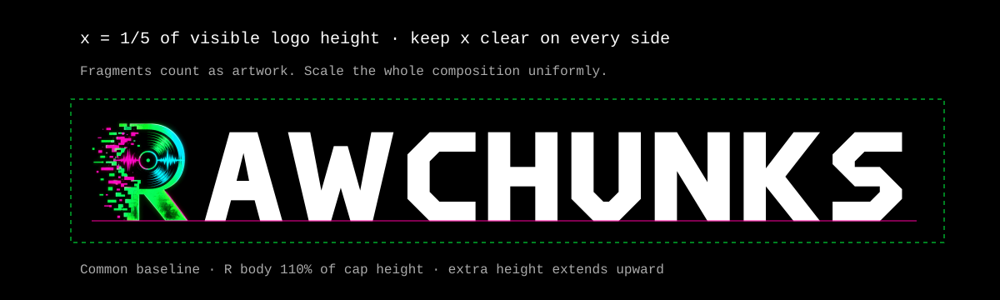
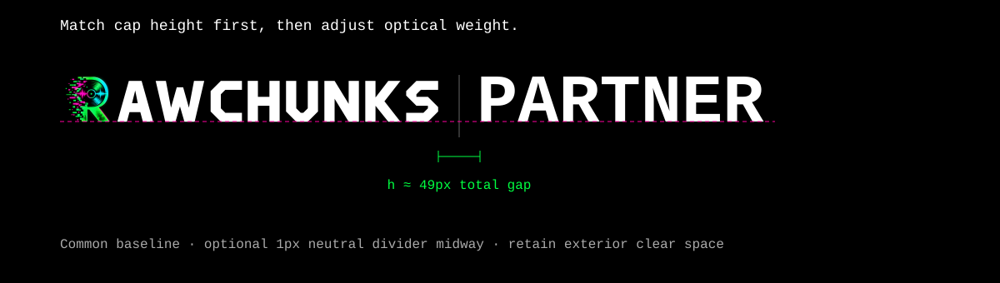

# Rawchunks brand guidelines

Version 1.1 · 21 October 2026

Rawchunks is a music production suite for creating, editing, licensing and remixing music. Its signature R combines a record, waveform and digital fragments. The established manifesto is **CREATE AT YOUR OWN CONDITIONS.**

## Choose the asset by its job

| Situation | Use | File / treatment |
|---|---|---|
| Website header, press article, event listing, external product mention | Full-name logo | `logos/rawchunks-logo-*` |
| Partner lockup, presentation title, first introduction | Full-name logo | Keep R and AWCHUNKS together |
| Product identity already named nearby; expressive brand placement | Standalone R | `logos/rawchunks-mark-*` |
| Square space where the full name must remain visible | Compact mark + name | `logos/rawchunks-compact-*` |
| Social profile or directory avatar | Square or circular profile | `profiles/`; black or white field |
| Browser tab | Dedicated favicon | `icons/favicon.ico` or `icons/icon.svg` |
| Home-screen shortcut | Dedicated platform icon | `icons/apple-touch-icon.png` or `shortcut.png` |
| One-color document | Black or white artwork | `black-only` on light; `white-only` on dark |

The full-name logo introduces Rawchunks. The R works when the name is already established or the interface provides a text label. In a partner banner, use the full name so both brands can be identified. The compact composition is for a near-square placement; a wide logo should remain horizontal.

## Logo construction and spacing

The full-name logo is a finished composition. The record R body is **110% of the 64-unit AWCHUNKS cap height**. Its visible body shares the letters' baseline. All extra height extends upward. The **R–A optical gap is 12 units** before the original angular letter paths. Preserve the whole composition; do not move the R, retype the letters, or center the R vertically against the name.

Let **x = one fifth of the visible artwork height**. Leave at least x clear outside the visible artwork on all four sides. Count the scattered fragments as artwork. Clear space is measured from the ink, not the image canvas. Supplied transparent logos have close-fitting canvases; add the exclusion zone in your layout. Profile and shortcut files contain their own fitting and should not be padded again.

Example: a full-name logo shown at 300px wide has roughly 36px of visible artwork height, so reserve about 8px clear around its ink. A standalone R shown at 100px visible height needs 20px clear. A headline, image edge, divider or another logo must remain outside that space.

Start full-name digital use at **180 CSS px wide**. Below that, use the dedicated icon with a nearby text name instead of squeezing the full name. The detailed standalone R starts at **48 CSS px high**. At small sizes its texture simplifies naturally; the accepted favicon is a separate small-use composition. Inspect at the final display size, including on a mobile screen. A 2360px PNG does not mean it must appear at 2360px on the page.

For print, select the file for the intended process. At 300ppi, a 2360px-wide full-name PNG supports about 200mm width; the 1546 × 1638 dark standalone master supports about 131 × 139mm. These are pixel-density limits, not a print legibility guarantee. Ask the printer for a proof before fine-detail production.



## Background and color selection

- **Color dark:** native dark artwork and white letters. Use on black or the existing near-black surfaces.
- **Color light:** separately supplied native light artwork and black letters. Use on white. It is not a color inversion.
- **Black only:** one black color with texture/opacity, on white or a light neutral.
- **White only:** one white color with texture/opacity, on black or a dark neutral.
- **Profile fields:** intentional black/white square or circular backgrounds. Use these for profile crops; use the transparent logo assets for normal placement.

On photography, choose a quiet area with adequate contrast and full clear space. If the image is busy, place the logo on a separate black or white panel. Preserve the photo's original treatment. Do not add a border, drop shadow, extra glow, colored frame, rotation, distortion, new gradient or arbitrary recoloring to make a logo fit.

The artwork already contains glow and fragments: those belong to the supplied signature. Do not add similar effects to every heading or partner logo. Never crop off the digital fragments or substitute an obsolete R.

## Color palette

| Role | HEX | RGB | Contrast on black | Contrast on white |
|---|---|---|---|---|
| Primary / acid green | #00FF41 | 0,255,65 | 15.38:1 | 1.37:1 |
| Secondary / magenta | #FF00A0 | 255,0,160 | 5.76:1 | 3.65:1 |
| Accent / cyan | #00CCFF | 0,204,255 | 11.08:1 | 1.90:1 |
| Main dark field | #000000 | 0,0,0 | — | 21:1 |
| Light field / primary text | #FFFFFF | 255,255,255 | 21:1 | — |

Neutrals in the product: #0A0A0A, #121212 and #181818 for surfaces; #AAAAAA for secondary text. Use neutrals for the majority of a layout. Green is the primary accent; magenta and cyan are supporting accents. A partner's artwork retains its own colors.

For normal text, use at least 4.5:1 contrast; large text requires 3:1. White/green/cyan/magenta work on black. On white, use black for text; green and cyan do not provide readable text contrast, and magenta is limited to large text. Pair color with text or shape for functional meaning. Decorative logo color is distinct from text accessibility.

Amber #FFAA00 and error #FF0066 are product status colors; do not use them as extra logo treatments. No universal CMYK/Pantone values are specified. Print output depends on paper, ink and the printer's color profile; require a proof.

## Typography: roles, settings and software

Use **Courier New**, with **Courier**, then **monospace** as fallbacks. Use real regular (400) and bold (700). The angular AWCHUNKS lettering is custom artwork, not Courier, and is supplied as paths. Do not type the logo from a font.

| Role | Size / line height | Weight | Tracking / case |
|---|---|---|---|
| Website hero | 30–60px / 1.2 | 700 | −0.03em; short title |
| Section heading | 28–42px / 1.2 | 700 | −0.03em; sentence case |
| Subheading | 22px / 1.2 | 700 | 0; sentence case |
| Body | 15px / 1.65 | 400 | 0; sentence case |
| Supporting copy | 13px / 1.65 | 400 | 0; sentence case |
| Compact label | 11px / 1.3 | 400 or 700 | +0.04em; short uppercase |
| Button / action | 13px / 1.3 | 700 | +0.04em; brief uppercase |

These are public website and communication defaults drawn from the existing landing styles. Dense app controls have their own responsive tokens; this guide does not change those controls. For long reading, keep lines around 45–70 characters and left align them. Limit all-caps treatment to short labels, titles where appropriate and the manifesto. Avoid long uppercase paragraphs, forced justification, squeezing/stretching text, fake bold, or decorative effects on prose.

Web example:

```css
font-family: 'Courier New', Courier, monospace;
font-weight: 400;
font-size: 15px;
line-height: 1.65;
letter-spacing: 0;
```

In Figma, Illustrator or presentation software, select Courier New Regular/Bold and use the same hierarchy. Point sizes depend on the canvas; use the supplied templates as starting layouts. If the software only accepts points, 15 CSS px corresponds to 11.25pt at 96dpi. Check wrapping after substitution. The kit does not redistribute font binaries or imply a font license. Use a legitimately available font; when using Courier fallback, review every line break and alignment.

The actual application templates adapt the type roles to their canvases: 58/70px headline and 24/34px body on a 1200 × 630 announcement; 76/91px title on square social; 92/111px title and 32/45px body on a 1920 × 1080 slide. Keep text as editable text while designing; preserve the logo as supplied artwork.

## Partner logos and banners

### Horizontal lockup

Use the full-name Rawchunks logo on the left and the partner logo on the right. Start the partner wordmark at the **same lettering cap height** as AWCHUNKS. Then adjust the partner artwork uniformly until neither logo overwhelms the other. Compare visible ink and visual weight, not file dimensions or empty canvas. A tall symbol may need optical centering; wordmarks align on their visible baseline.

Let **h = AWCHUNKS cap height**. Leave **one h total** between the visible logos. If using a divider, place a **1px neutral line** at the midpoint, giving each side **h/2** clearance. Keep the exterior logo exclusion zone x around the entire pair. Use a neutral separator, not a green frame or decorative slash. Partner colors and proportions stay intact.

Example: if AWCHUNKS cap height is 48px, start the partner wordmark around 48px tall, leave 48px between the logos and place a divider 24px from each side. The supplied horizontal template starts at about 49px lettering height. Replace its `PARTNER` group with the actual approved logo, then re-check optical weight.



### Narrow / stacked lockup

Use a stacked pair only if the horizontal version would make the full name smaller than its minimum size. Rawchunks above, partner below, both optically centered. Leave one h on each side of an optional horizontal divider. Preserve equal visual prominence and the outer exclusion zone. Do not put the standalone R above a partner name when Rawchunks itself is not otherwise named.

### Partner announcement banner

Use `templates/rawchunks-partner-announcement.svg`, **1200 × 630**, for an announcement image or link preview. Keep **64px outer margins**. Put the balanced logo pair in the upper area; separate it from a specific, two-line headline with a neutral rule. Use the lower area for a brief explanation and URL. Keep the logos clear of the headline and image. The template is editable; placeholders must be replaced before publication.

Choose the correct relationship label:

- **Partner / in partnership with:** an agreed partnership that both organizations authorize.
- **Integrates with:** a technical integration. It does not by itself imply partnership or endorsement.
- **Created with Rawchunks:** attribution for work created using the product; not a co-brand partnership.

Use the partner's permitted artwork and usage terms. Do not publish a co-brand composition that implies a relationship that does not exist. Third-party logos in a directory or integration list should be in equal visual slots with a text name, not welded into the Rawchunks signature.

## Other useful applications

**Website partner strip:** a neutral row or grid. Use the full-name logo, approximately 36–48px visible lettering height, 24px outer inset and at least one cap-height spacing between brands. Scale each logo inside its slot by optical weight. On mobile, wrap to a grid; preserve minimum sizes and text labels.

**Social post:** use the editable **1080 × 1080** layout with **64px margins**. A short headline takes priority. Use a real workstation image, screenshot or existing studio photo in the image panel; preserve its original color and composition. Use the circular/square profile asset for the account avatar, not the full-name logo shrunk into a circle.

**Presentation:** the **1920 × 1080** layout has **96px margins**, one short headline, readable supporting copy and a large image area. On the title slide use the full name. On content slides use a modest full-name footer or a small R only after the brand has been introduced. Keep speaker/date text and slide information outside logo clear space.

**Email signature:** the supplied HTML table includes the light full-name PNG, name, role and a linked site URL. Host the PNG at a stable public HTTPS URL, replace the relative path, and copy the rendered table into the email client. SVG and embedded data URLs are unreliable in email. Keep contact text available if images are blocked. Send yourself a test in the actual client.

**Document / one-color reproduction:** use black-only on white, white-only on dark. The detailed mono artwork contains opacity and continuous-tone texture. It is appropriate for monochrome digital/printed layouts. Die cutting, embroidery, stamps, spot-ink screens and engraving may require a separately approved solid-ink production drawing; do not claim the supplied bitmap is automatically suitable for those processes.

## Imagery, language and motion

Preserve existing studio photography. Use screenshots of real product states when explaining functionality. Crop for the target frame without changing the subject or adding neon recoloring. Do not replace photographic identity with generic generated visuals.

Use direct verbs and concrete musical terms: create, edit, layer, remix, license. Write what someone can do and the result. Keep long explanations in sentence case. The manifesto stays **CREATE AT YOUR OWN CONDITIONS.** Avoid unsupported claims about ownership, licensing, earnings, technology or partnerships.

The kit is static. Existing web transitions are about 150ms and respect reduced-motion preferences. No animated logo variant is specified; do not invent motion for the signature during a routine placement.

## Files and production limits

- **SVG:** self-contained compositions. AWCHUNKS lettering is vector. The final R is embedded native raster artwork, so its texture remains resolution-limited. These files are not a traced vector recreation.
- **PNG:** transparent full-name logos at 2360px wide; standalone marks at native prepared resolution; compact/profile compositions at 1024px. One intended export per application, with no size ladder.
- **Icons:** the accepted browser/platform assets, distinct from the detailed standalone artwork.
- **Templates:** editable SVG or HTML, one canvas per situation. Export the final edited composition at the destination size.

The website contains small previews and a single downloadable kit. Original supplied artwork and production backups are kept outside the landing repository. Download the full kit for design work or the individual full-name logo for a simple attribution. Native artwork can still lose texture if displayed far beyond its source resolution; upsizing does not create detail.
